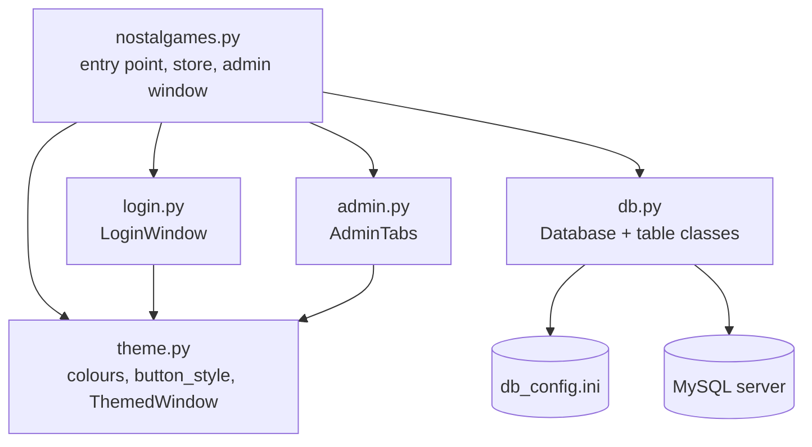
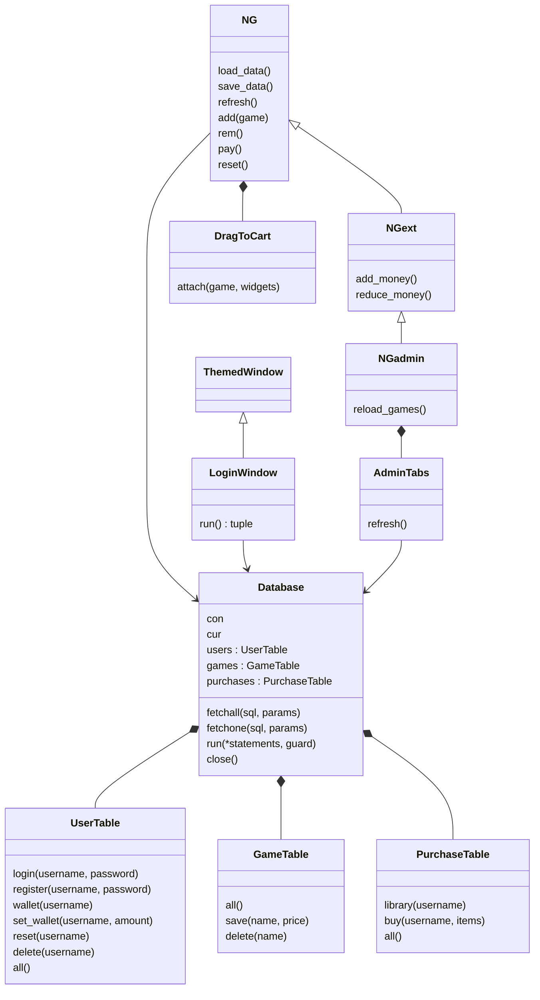
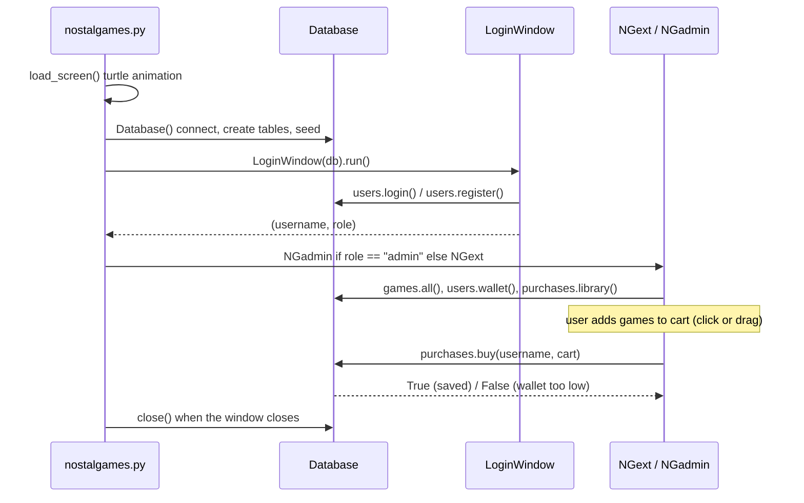

# Architecture

How NOSTALgames is put together: the modules, the classes in each, and how a session flows from launch to purchase.

## Modules

Only `db.py` talks to MySQL. The screens never write SQL; they call methods such as `db.users.login(...)` or `db.purchases.buy(...)`.

## Classes

| Class | File | Responsibility |
|---|---|---|
| `Database` | `db.py` | Reads `db_config.ini`, connects, creates the database and tables, adds starting data, runs queries and transactions |
| `UserTable`, `GameTable`, `PurchaseTable` | `db.py` | All SQL for one table each |
| `ThemedWindow` | `theme.py` | Base `tk.Tk` window with the app colours and `clam` theme |
| `LoginWindow` | `login.py` | Login and registration; `run()` returns `(username, role)` or `None` |
| `NG` | `nostalgames.py` | The store window: header, STORE / LIBRARY / SETTINGS tabs, cart, purchase, reset |
| `NGext` | `nostalgames.py` | Adds Wallet Management (ADD / REDUCE) to SETTINGS |
| `NGadmin` | `nostalgames.py` | The admin's window: the full store plus `AdminTabs` |
| `DragToCart` | `nostalgames.py` | Drag a game row onto the cart to add it |
| `AdminTabs` | `admin.py` | USERS, GAMES and PURCHASES tabs added to the admin's notebook |

Design choices:

- **Composition over inheritance where behaviour is optional.** Drag and drop (`DragToCart`) and the admin tabs (`AdminTabs`) are separate objects plugged into the store window rather than baked into `NG`.
- **One connection per run.** `Database` is created once in `__main__` and passed to every screen.
- **`ttk.Button` everywhere.** `tk.Button` ignores background colours on macOS, which hid white button text. `button_style()` in `theme.py` defines each button's colours, including pressed and hover states.

## Runtime flow

1. **Loading screen.** `load_screen()` draws the turtle animation in an 800×600 window centred on the screen, then closes it. It runs from inside the `NG` class body, so it plays when `nostalgames.py` is loaded.
2. **Connect.** `open_database()` creates `Database()`. Any connection or config error is shown in a popup and the app exits.
3. **Login.** `LoginWindow` loops until the user logs in or closes the window.
4. **Store.** Users get `NGext`; admins get `NGadmin`. Closing the window ends the program.

## Purchase flow

1. Games reach the cart through `NG.add()`, either from the price button or from `DragToCart.drop()`. A game already in the cart is not added twice. Owned games show **IN LIBRARY** and can't be dragged.
2. `NG.pay()` calls `db.purchases.buy(username, {game: price})`.
3. `buy()` runs one transaction. It first runs `UPDATE users SET wallet = wallet - cost WHERE username = ? AND wallet >= cost`. If no row changes, the wallet is too low, so everything is rolled back and `False` is returned. Otherwise it inserts one `purchases` row per game and commits.
4. `pay()` reloads the wallet and library from MySQL and redraws the store, then shows **Purchased!** or **Check funds or cart.**

Because the wallet check happens in SQL against the stored value, a purchase can't overdraw the wallet even if the wallet was changed in MySQL Workbench while the app was open.
