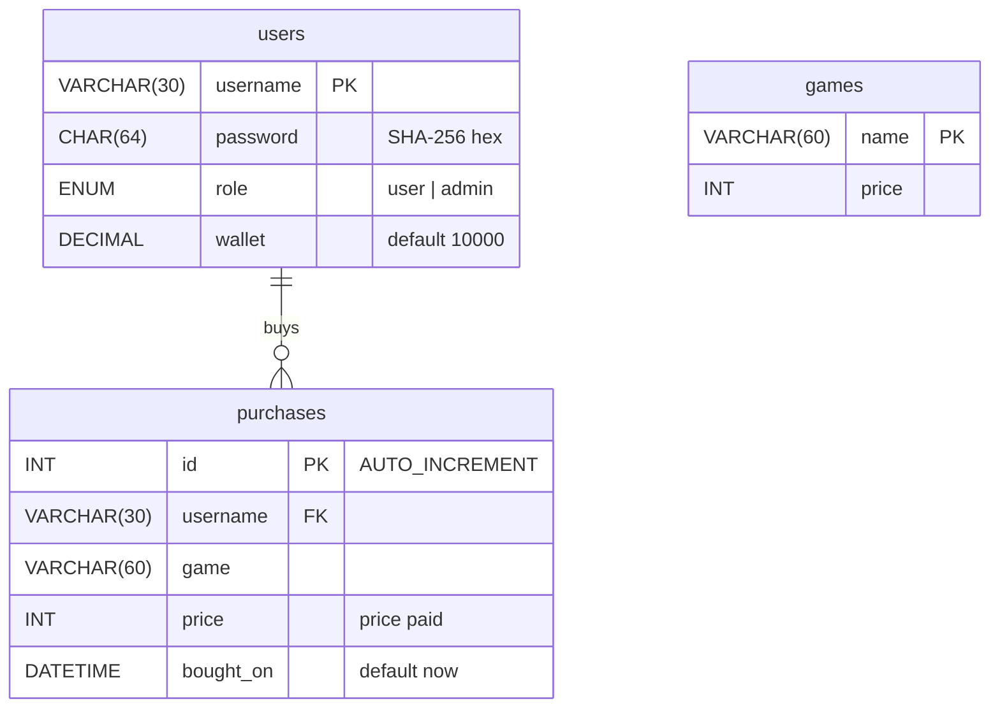

# Database

NOSTALgames stores everything in a MySQL database (default name `nostalgames`). `db.py` creates it automatically on the first run.

## Connection settings

`Database` reads `db_config.ini` (copy it from `db_config.example.ini`):

| Section | Key | Default | Meaning |
|---|---|---|---|
| `[mysql]` | `host` | `localhost` | MySQL server host |
| `[mysql]` | `port` | `3306` | MySQL server port |
| `[mysql]` | `user` | (required) | MySQL user, e.g. `root` |
| `[mysql]` | `password` | empty | Password for that user |
| `[mysql]` | `database` | `nostalgames` | Database to create and use; must be a valid identifier |
| `[app]` | `admin_password` | `admin123` | Password given to the `admin` account when no admin exists yet |

The connection uses `autocommit=True`, so every `SELECT` sees the latest data, including changes made in MySQL Workbench while the app is running. Writes still go through explicit transactions (see [Transactions](#transactions)).

## What happens on start-up

```sql
CREATE DATABASE IF NOT EXISTS nostalgames CHARACTER SET utf8mb4;
USE nostalgames;
-- then the three CREATE TABLE IF NOT EXISTS statements below
```

After that:

- If `games` is empty, the 12 default games are inserted.
- If there is no user with `role = 'admin'`, an `admin` account is created with `admin_password`.

Every statement is `IF NOT EXISTS` or "only if empty", so restarting the app never wipes data. `utf8mb4` is needed for names like `FC™ 26`.

## Tables



```sql
CREATE TABLE IF NOT EXISTS users (
    username VARCHAR(30) PRIMARY KEY,
    password CHAR(64) NOT NULL,
    role ENUM('user', 'admin') NOT NULL DEFAULT 'user',
    wallet DECIMAL(10, 2) NOT NULL DEFAULT 10000);

CREATE TABLE IF NOT EXISTS games (
    name VARCHAR(60) PRIMARY KEY,
    price INT NOT NULL);

CREATE TABLE IF NOT EXISTS purchases (
    id INT AUTO_INCREMENT PRIMARY KEY,
    username VARCHAR(30) NOT NULL,
    game VARCHAR(60) NOT NULL,
    price INT NOT NULL,
    bought_on DATETIME DEFAULT CURRENT_TIMESTAMP,
    UNIQUE (username, game),
    FOREIGN KEY (username) REFERENCES users(username) ON DELETE CASCADE);
```

Rules these definitions enforce:

- **One copy per game:** `UNIQUE (username, game)` stops a user owning the same game twice.
- **Deleting a user deletes their purchases** (`ON DELETE CASCADE`).
- **Removing a game keeps it in libraries:** `purchases.game` is deliberately not a foreign key to `games`, so people who bought a game keep it after the admin removes it from the store. The price they paid is stored with the purchase.

## Default games

| Game | Price (₹) |
|---|---|
| Cyberpunk 2077 | 2999 |
| Elden Ring | 3500 |
| Stardew Valley | 479 |
| Hollow Knight | 600 |
| Doom Eternal | 1799 |
| Forza Horizon 5 | 3499 |
| Forza Horizon 6 | 4599 |
| Counter Strike 2 | 1399 |
| Subnautica 2 | 1799 |
| NBA 2K26 | 3999 |
| Red Dead Redemption 2 | 4999 |
| FC™ 26 | 1625 |

The store lists these in the order above. Games added later by an admin appear after them, A–Z.

## Passwords

Passwords are never stored as plain text. `hash_password()` stores the SHA-256 hex digest, and login compares hashes:

```sql
SELECT role FROM users WHERE username = %s AND password = %s   -- password = sha256(entered password)
```

MySQL's `SHA2(text, 256)` produces the same value, so users can also be added straight from SQL:

```sql
INSERT INTO users (username, password) VALUES ('rahul', SHA2('pass123', 256));
```

SHA-256 without a salt is fine for a school project. A production system should use a slow, salted hash such as bcrypt or Argon2.

## Queries used by the app

| Method | SQL |
|---|---|
| `users.login` | `SELECT role FROM users WHERE username = %s AND password = %s` |
| `users.register` | `INSERT INTO users (username, password) VALUES (%s, %s)` |
| `users.wallet` | `SELECT wallet FROM users WHERE username = %s` |
| `users.set_wallet` | `UPDATE users SET wallet = %s WHERE username = %s` |
| `users.reset` | `DELETE FROM purchases WHERE username = %s` + `UPDATE users SET wallet = 10000 ...` (one transaction) |
| `users.delete` | `DELETE FROM users WHERE username = %s AND role = 'user'` |
| `users.all` | `SELECT u.username, u.role, u.wallet, COUNT(p.id) FROM users u LEFT JOIN purchases p ... GROUP BY ...` |
| `games.all` | `SELECT name, price FROM games` |
| `games.save` | `INSERT INTO games (name, price) VALUES (%s, %s) ON DUPLICATE KEY UPDATE price = %s` |
| `games.delete` | `DELETE FROM games WHERE name = %s` |
| `purchases.library` | `SELECT game FROM purchases WHERE username = %s ORDER BY bought_on` |
| `purchases.buy` | guarded `UPDATE users SET wallet = wallet - %s WHERE username = %s AND wallet >= %s`, then one `INSERT INTO purchases ...` per game |
| `purchases.all` | `SELECT username, game, price, bought_on FROM purchases ORDER BY bought_on DESC` |

Every value is passed through a `%s` placeholder, never pasted into the SQL string, which prevents SQL injection. The one exception is the database name in `CREATE DATABASE` / `USE`; it comes from the config file and is checked with `str.isidentifier()` first.

## Transactions

`Database.run(*statements, guard=None)` is the only method that writes:

1. `start_transaction()`
2. If a `guard` statement is given, run it first. If it changes no rows, call `rollback()` and return `False`.
3. Run the remaining statements.
4. `commit()` and return `True`. On any MySQL error, `rollback()` and re-raise.

`purchases.buy` uses the guard to charge the wallet only if it can cover the total, so a purchase either saves completely or not at all.

## Class 12 connectivity concepts in this project

| Syllabus concept | Where it is used |
|---|---|
| `import mysql.connector` | `db.py` |
| `mysql.connector.connect(host, user, password, ...)` | `Database.__init__` |
| `con.cursor()` | `Database.__init__` (`self.cur`) |
| `cur.execute(query)` | creating the database and tables |
| `cur.execute(query, params)` with `%s` | every query in the table classes |
| `cur.fetchone()` | `Database.fetchone`: login, wallet, admin check |
| `cur.fetchall()` | `Database.fetchall`: game list, library, admin tables |
| `cur.rowcount` | `Database.run`: detecting a failed wallet check |
| `con.commit()` / `con.rollback()` | `Database.run` |
| `con.close()` | `Database.close`, when the app exits |

## Useful SQL for MySQL Workbench

```sql
USE nostalgames;
SHOW TABLES;

-- all users with wallet and number of games
SELECT u.username, u.role, u.wallet, COUNT(p.id) AS games
FROM users u LEFT JOIN purchases p ON p.username = u.username
GROUP BY u.username, u.role, u.wallet;

-- best-selling games
SELECT game, COUNT(*) AS sold, SUM(price) AS revenue
FROM purchases GROUP BY game ORDER BY sold DESC;

-- give a user more money
UPDATE users SET wallet = wallet + 5000 WHERE username = 'rahul';

-- make someone an admin
UPDATE users SET role = 'admin' WHERE username = 'rahul';

-- start completely fresh (the app recreates everything on next run)
DROP DATABASE nostalgames;
```
