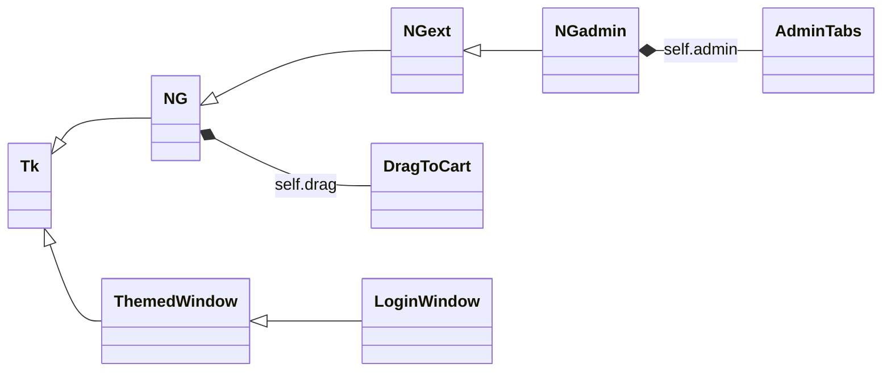

# Feature Internals

Code-level documentation for each NOSTALgames feature: which classes and methods implement it, how control and data flow through them, and the edge cases. For the big picture see [architecture.md](../architecture.md); for end-user instructions see [user-guide.md](../user-guide.md).

## Feature map

| Feature | Doc | Main code |
|---|---|---|
| Loading screen | [loading-screen.md](loading-screen.md) | `load_screen()` in `nostalgames.py` |
| Login and registration | [login-and-registration.md](login-and-registration.md) | `LoginWindow` (`login.py`), `UserTable.login` / `register` (`db.py`) |
| Store, cart and library | [store-and-cart.md](store-and-cart.md) | `NG.__init__`, `refresh`, `add`, `rem` (`nostalgames.py`) |
| Drag and drop to cart | [drag-and-drop.md](drag-and-drop.md) | `DragToCart` (`nostalgames.py`) |
| Store scrolling | [store-scrolling.md](store-scrolling.md) | `NG.bind_scroll`, `scroll_store` (`nostalgames.py`) |
| Purchase | [purchase.md](purchase.md) | `NG.pay` (`nostalgames.py`), `PurchaseTable.buy`, `Database.run` (`db.py`) |
| Wallet and reset | [wallet-and-reset.md](wallet-and-reset.md) | `NGext.add_money` / `reduce_money`, `NG.reset` (`nostalgames.py`), `UserTable.set_wallet` / `reset` (`db.py`) |
| Admin panel | [admin-panel.md](admin-panel.md) | `NGadmin` (`nostalgames.py`), `AdminTabs` (`admin.py`) |
| Theme and buttons | [theme-and-buttons.md](theme-and-buttons.md) | `button_style`, `ThemedWindow` (`theme.py`) |

The database layer (connection, schema, transactions, every query) is documented in [database.md](../database.md).

## Shared conventions

- **Screens never write SQL.** They call `self.db.<table>.<method>()`, e.g. `self.db.purchases.buy(...)`. All SQL lives in `db.py`.
- **One `Database` object** is created in `__main__` and passed into every window.
- **Redraw, don't patch.** After any data change the store calls `load_data()` (re-read wallet and library from MySQL) and `refresh()` (rebuild the store and library widgets).
- **`ttk.Button` with a named style** for every button, so colours work on macOS (see [theme-and-buttons.md](theme-and-buttons.md)).
- **Colour shorthands** used throughout: `B` page background, `DB` dark panels, `NAV` blue accents, `LB` green price text, `TXT` light grey text, `WALT` yellow wallet/highlight, `PRCHS` purchase green, `RED` danger.

## Class hierarchy at a glance

