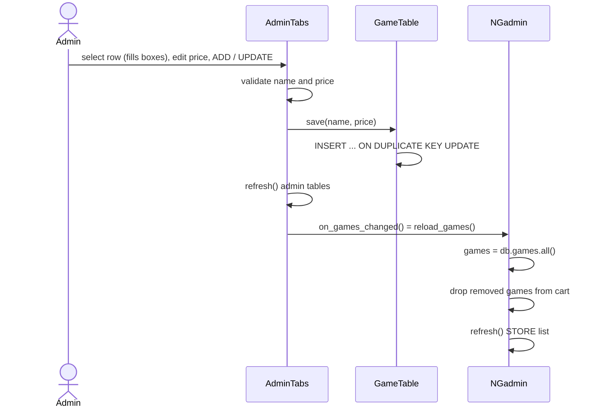

# Admin Panel

Admins get the full player window (STORE, LIBRARY, SETTINGS, with their own wallet) plus USERS, GAMES and PURCHASES tabs.

## Code

| Piece | File | Role |
|---|---|---|
| `NGadmin(NGext)` | `nostalgames.py` | The admin's window; adds `AdminTabs`, reloads the catalogue when games change |
| `AdminTabs` | `admin.py` | Builds and runs the three admin tabs inside an existing notebook |
| `UserTable.all` / `reset` / `delete` | `db.py` | USERS tab queries |
| `GameTable.all` / `save` / `delete` | `db.py` | GAMES tab queries |
| `PurchaseTable.all` | `db.py` | PURCHASES tab query |

## How the admin window is assembled

```python
class NGadmin(NGext):
    def __init__(self, db, username):
        super().__init__(db, username)                         # full store + wallet controls
        self.admin = AdminTabs(self, self.nb, db, on_games_changed=self.reload_games)

    def reload_games(self):
        self.games = self.db.games.all()
        for i in reversed(range(len(self.cart))):
            if self.cart[i] not in self.games: self.cart.pop(i); self.lbx.delete(i)
        self.refresh()
```

- **Inheritance** gives the admin everything a player has (`NGadmin` → `NGext` → `NG`).
- **Composition** adds the admin tabs. `AdminTabs` is a plain object, not a window. It receives the notebook to add its tabs to and a callback to run when games change, so it doesn't need to know anything about `NG`.
- `reload_games` walks the cart backwards so removing item *i* doesn't shift the indexes of items still to be checked, keeping `self.cart` and the listbox aligned.

`__main__` picks the class by role:

```python
(NGadmin if role == "admin" else NGext)(db, username).mainloop()
```

## `AdminTabs` building blocks

```python
def table(self, parent, columns):      # ttk.Treeview with one heading per column
def toolbar(self, parent):             # a frame under the table for buttons
def selected(self, tree):              # values of the selected row, or None
@staticmethod
def fill(tree, rows):                  # clear and insert rows
def refresh(self):                     # refill all three tables from MySQL
```

All three tabs are a table plus a toolbar, built from these shared helpers. `refresh()` also runs on every tab switch:

```python
notebook.bind("<<NotebookTabChanged>>", lambda e: self.refresh(), add="+")
```

`add="+"` keeps any other handler already bound to that event.

## USERS tab

Columns: `username`, `role`, `wallet`, `games`, from:

```sql
SELECT u.username, u.role, u.wallet, COUNT(p.id)
FROM users u LEFT JOIN purchases p ON p.username = u.username
GROUP BY u.username, u.role, u.wallet ORDER BY u.role, u.username
```

`LEFT JOIN` keeps users with no purchases (count 0).

```python
def selected_user(self):
    row = self.selected(self.users_tree)
    if not row or row[1] != "user":
        messagebox.showerror("Users", "Select a non-admin user first.")
        return None
    return row[0]
```

| Button | Calls | SQL |
|---|---|---|
| RESET USER | `db.users.reset(u)` | `DELETE FROM purchases WHERE username = %s` + wallet back to 10000 (one transaction) |
| DELETE USER | `db.users.delete(u)` | `DELETE FROM users WHERE username = %s AND role = 'user'`; purchases go via `ON DELETE CASCADE` |

Admins are protected twice: in the UI (`selected_user`) and in SQL (`AND role = 'user'`).

## GAMES tab

```python
def load_game_form(self, _event):                 # <<TreeviewSelect>>: copy row into the boxes
def save_game(self):
    name, price = self.game_name.get().strip(), self.game_price.get().strip()
    if not name or len(name) > 60 or not price.isdigit(): ...error...; return
    self.db.games.save(name, int(price)); self.games_changed()
def delete_game(self):
    row = self.selected(self.games_tree)
    if row and messagebox.askyesno(...): self.db.games.delete(row[0]); self.games_changed()
def games_changed(self):
    self.refresh(); self.on_games_changed()       # admin tables, then NGadmin.reload_games
```

`GameTable.save` is an upsert, so one button covers both add and update:

```sql
INSERT INTO games (name, price) VALUES (%s, %s) ON DUPLICATE KEY UPDATE price = %s
```

`price.isdigit()` accepts only whole non-negative numbers (no `-`, `.` or spaces). `60` matches the `VARCHAR(60)` column.

## PURCHASES tab

Read-only:

```sql
SELECT username, game, price, bought_on FROM purchases ORDER BY bought_on DESC
```

It refreshes on every tab switch, so a purchase made in the admin's own STORE shows up as soon as the tab is opened.

## Flow: editing a game



## Styles

`AdminTabs.__init__` registers the `Nav` and `Danger` button styles and a dark `Treeview` / `Treeview.Heading` style on the same window, using `button_style()` from `theme.py`.

## Edge cases

- **Removing a game** deletes it from `games` only. Existing `purchases` rows keep it, so buyers still see it in their LIBRARY, but it no longer appears in the STORE.
- **Players' open windows** don't see catalogue changes until they restart; only the admin's window reloads.
- **No ADD USER button.** Players self-register, or an admin inserts a row in SQL (see [database.md](../database.md#passwords)).
- **Renaming a game** isn't supported. Typing a new name adds a new game; the old one has to be removed separately.
