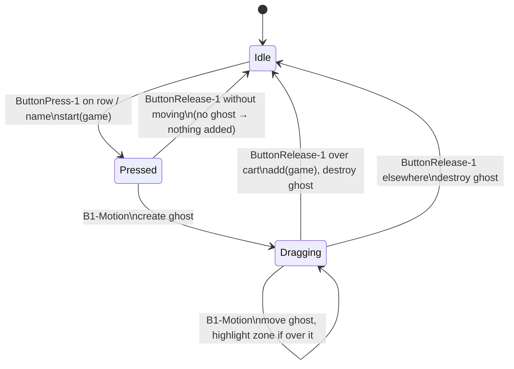

# Drag and Drop to Cart

Drag a game row from the STORE list and drop it on the SHOPPING CART to add it. Clicking the price button still works; both paths end in `NG.add()`.

## Code

`DragToCart` in `nostalgames.py`, created once in `NG.__init__`:

```python
self.drag = DragToCart(self, cf, self.add)   # root window, drop zone (cart frame), callback
```

and attached to each unowned game in `NG.refresh()`:

```python
self.drag.attach(g, row, name)               # the row frame and its name label
```

| Method | Trigger | Does |
|---|---|---|
| `__init__(root, drop_zone, on_drop)` | once | remembers the window, the drop zone and its normal background |
| `attach(game, *widgets)` | each `refresh()` | hand cursor + three mouse bindings per widget |
| `start(game)` | `<ButtonPress-1>` | remember which game is being dragged |
| `move(e)` | `<B1-Motion>` | create/move the ghost label, highlight the zone when hovering it |
| `over_zone(e)` | helper | is the pointer inside the drop zone? |
| `drop(e)` | `<ButtonRelease-1>` | call `on_drop(game)` if dropped on the zone, then clean up |

## How it works

### 1. Binding

```python
def attach(self, game, *widgets):
    for w in widgets:
        w.configure(cursor="hand2")
        w.bind("<ButtonPress-1>", lambda e, g=game: self.start(g))
        w.bind("<B1-Motion>", self.move)
        w.bind("<ButtonRelease-1>", self.drop)
```

Tk delivers all motion and release events to the widget where the button was pressed (an implicit grab), even after the pointer leaves it. That's why a binding on the row is enough to track the whole drag across the window.

### 2. Ghost label

```python
def move(self, e):
    if not self.game: return
    if not self.ghost:
        self.ghost = tk.Label(self.root, text=f"🎮 {self.game}", bg=WALT, fg="black", ...)
    self.ghost.place(x=e.x_root - self.root.winfo_rootx() + 12,
                     y=e.y_root - self.root.winfo_rooty() + 12)
    self.ghost.lift()
    self.zone.configure(bg=NAV if self.over_zone(e) else self.zone_bg)
```

- The ghost is a normal `Label` placed on the root window with `place()`, so it can float over the notebook and the cart.
- `e.x_root` / `e.y_root` are screen coordinates. Subtracting the window's screen position gives coordinates inside the window. The `+12` keeps the label just below and to the right of the pointer, so it doesn't sit under it.
- The ghost is only created on the first motion. A plain click without moving never creates one, and `drop()` checks for a ghost before adding, so clicking a row does nothing.

### 3. Hit test

```python
def over_zone(self, e):
    x, y = e.x_root - self.zone.winfo_rootx(), e.y_root - self.zone.winfo_rooty()
    return 0 <= x < self.zone.winfo_width() and 0 <= y < self.zone.winfo_height()
```

A rectangle check in screen coordinates against the cart frame `cf`, which includes its title, listbox and buttons.

### 4. Drop and clean-up

```python
def drop(self, e):
    if self.game and self.ghost and self.over_zone(e): self.on_drop(self.game)
    if self.ghost: self.ghost.destroy()
    self.zone.configure(bg=self.zone_bg)
    self.game = self.ghost = None
```

`on_drop` is `NG.add`, which ignores games already in the cart.

## Flow



## Design notes

- **Composition:** `DragToCart` knows nothing about games, carts or MySQL. It only needs a root window, a drop zone and a callback, so it could be reused for another drop target.
- **Re-attached on every `refresh()`.** Rows are destroyed and rebuilt, and destroyed widgets take their bindings with them.
- **Owned games are never attached**, so they can't be dragged.

## Edge cases

- **Window loses focus mid-drag** (e.g. Cmd-Tab): Tk may not deliver the release event, so the ghost can stay until the next press and release on a row.
- **The drop zone is the whole cart panel**, including its buttons. Dropping onto the PURCHASE button adds the game; it does not buy it.
