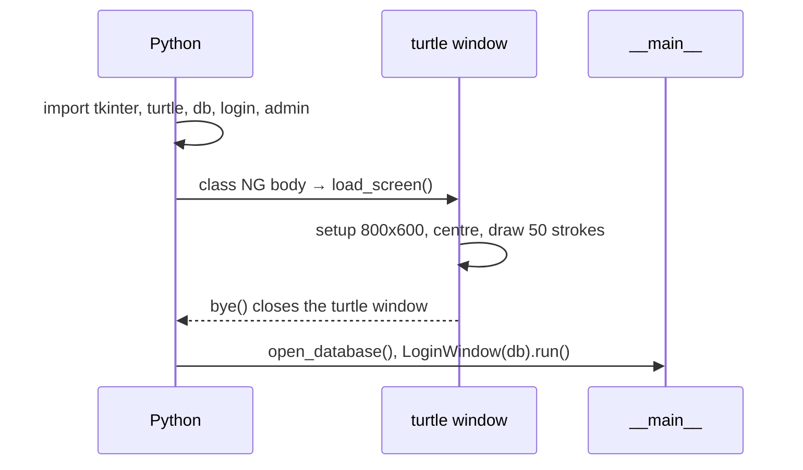

# Loading Screen

A red turtle-graphics animation shown in its own window before the login screen.

## Code

`load_screen()` in `nostalgames.py`. It uses the module-level turtle functions brought in by `from turtle import*`.

```python
def load_screen():
    setup(800, 600)  # window centred on the screen
    getcanvas().update()
    # make the drawing area the same size as the window so (0,0) sits in the middle, not the top-left
    screensize(getcanvas().winfo_width(), getcanvas().winfo_height())
    title("NOSTALgames loading.....")
    bgcolor("black")
    speed(0)
    h=0
    for i in range(50):
        h+=0.0015
        color("red")
        goto(0,0)
        fd(i)
        circle(100,50)
        rt(10)
        hideturtle()
    bye()
```

## When it runs

It is called from inside the `NG` class body, not from `__main__`:

```python
class NG(tk.Tk):
    load_screen()
    def __init__(self, db, username):
```

Python executes a class body once, when the class is defined, which happens when `nostalgames.py` is loaded. So the animation plays before `__main__` connects to MySQL and opens the login window.



## How the drawing works

Each of the 50 iterations:

1. `goto(0,0)` returns to the centre.
2. `fd(i)` draws a straight line that gets 1 px longer each time.
3. `circle(100, 50)` draws a 50° arc of radius 100, curving left.
4. `rt(10)` turns right 10°.

The arc turns the heading 50° left and `rt(10)` turns it 10° right, so each stroke starts 40° further round than the last. That builds a rotating rosette around the centre. `speed(0)` draws as fast as possible. `h` is left over from the original code and is not used.

## Why `setup` and `screensize`

turtle draws on a canvas whose scroll region defaults to 400×300. When the window is bigger, Tk pins that small region to the top-left corner, so `(0,0)` appeared about 205×155 px from the corner instead of in the middle.

- `setup(800, 600)` fixes the window size. Leaving out the position arguments centres it on the screen.
- `getcanvas().update()` lets Tk lay out the window so its real canvas size is known.
- `screensize(width, height)` makes the scroll region exactly the visible canvas, so `(0,0)` is the centre.

## Edge cases

- **Importing the module plays the animation.** Any script that does `import nostalgames` (e.g. tests) shows the loader first.
- **Closing the turtle window mid-animation** raises `turtle.Terminator` and the app stops. Let it finish.
- **The turtle Tk root is destroyed by `bye()`** before the login window creates its own `tk.Tk()`, so the two never coexist.
