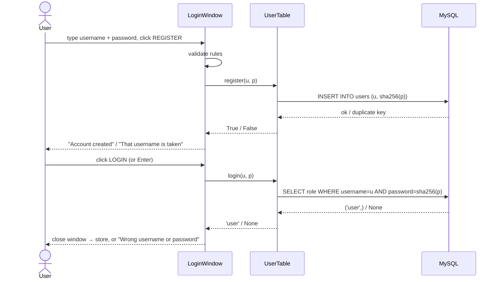

# Login and Registration

The first window after the loading screen. It returns who logged in and their role, which decides between the player window and the admin window.

## Code

| Piece | File | Role |
|---|---|---|
| `LoginWindow` | `login.py` | The window: two fields, LOGIN and REGISTER |
| `ThemedWindow` | `theme.py` | Base class: colours, `clam` theme, `Nav` button style |
| `UserTable.login` | `db.py` | Check credentials, return the role |
| `UserTable.register` | `db.py` | Insert a new `user` row |
| `hash_password` | `db.py` | SHA-256 hex digest of a password |
| `__main__` | `nostalgames.py` | Runs the login and opens the right window |

## Window construction

```python
class LoginWindow(ThemedWindow):
    def __init__(self, db):
        super().__init__("NOSTALgames - Login", "420x380")
        self.db, self.user = db, None
        ...
        self.username = self.field(box, "Username")
        self.password = self.field(box, "Password", show="*")
        ttk.Button(box, text="LOGIN", style="Login.TButton", command=self.login)...
        ttk.Button(box, text="REGISTER", style="Nav.TButton", command=self.register)...
        self.bind("<Return>", lambda e: self.login())
```

`field()` creates a label and an `Entry` bound to a `tk.StringVar`, and returns the variable. `show="*"` masks the password. Pressing **Enter** anywhere in the window calls `login()`.

## Login

```python
def login(self):
    username, password = self.credentials()          # username stripped, password as typed
    role = self.db.users.login(username, password)
    if not role:
        messagebox.showerror("Login failed", "Wrong username or password.")
        return
    self.user = (username, role)
    self.destroy()                                     # ends mainloop() in run()
```

`UserTable.login` hashes the typed password and asks MySQL for a matching row:

```python
row = self.db.fetchone("SELECT role FROM users WHERE username = %s AND password = %s",
                       (username, hash_password(password)))
return row[0] if row else None
```

The plain-text password never leaves the app and is never stored; only hashes are compared.

## Registration

```python
def register(self):
    username, password = self.credentials()
    if not (username.replace("_", "").isalnum() and len(username) <= 30) or len(password) < 4:
        messagebox.showerror(...rules...)
    elif self.db.users.register(username, password):
        messagebox.showinfo("Register", "Account created. You can log in now.")
    else:
        messagebox.showerror("Register", "That username is taken.")
```

- `username.replace("_", "").isalnum()` allows letters, digits and underscores. It is `False` for an empty string, so a blank username is rejected.
- `UserTable.register` runs `INSERT INTO users (username, password) VALUES (%s, %s)`. A duplicate primary key raises `mysql.connector.IntegrityError`, which is caught and turned into `False`.
- New rows get the column defaults: `role = 'user'`, `wallet = 10000`.

## Handing over to the store

```python
db = open_database()
user = LoginWindow(db).run() if db else None
if user:
    username, role = user
    (NGadmin if role == "admin" else NGext)(db, username).mainloop()
if db: db.close()
```

`run()` blocks in `mainloop()` until `login()` destroys the window (returning `(username, role)`) or the user closes it (returning `None`, and the app exits).

## Flow



## Default admin

On start-up `UserTable.seed_admin()` creates `admin` with the `[app] admin_password` from `db_config.ini` (default `admin123`), but only if no row has `role = 'admin'`. Changing `admin_password` later has no effect on an existing admin; update the hash in MySQL instead (see [database.md](../database.md#passwords)).

## Edge cases and limitations

- **Accented letters are accepted:** `isalnum()` is Unicode-aware, so usernames like `josé` pass validation.
- **Hashing:** unsalted SHA-256 is fine for a school project; production systems should use bcrypt or Argon2.
- **No lockout or rate limiting** on repeated wrong passwords.
- **No logout:** closing the store window ends the program.
