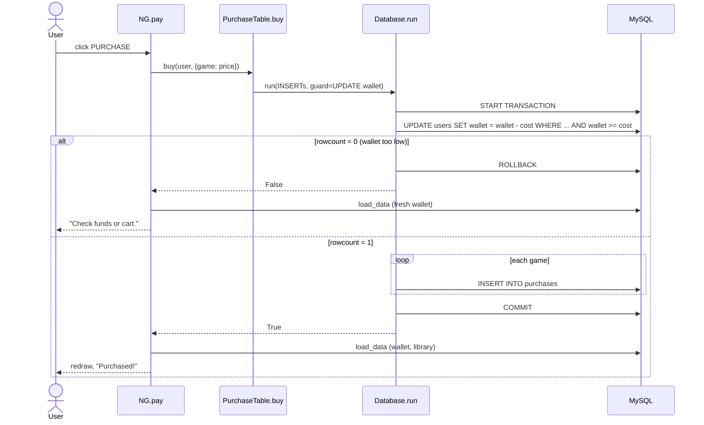

# Purchase

Buying everything in the cart: charge the wallet, record each game, update the screen. MySQL itself guarantees the wallet can't go negative and the purchase is all-or-nothing.

## Code

| Piece | File | Role |
|---|---|---|
| `NG.pay()` | `nostalgames.py` | PURCHASE button handler |
| `PurchaseTable.buy(username, items)` | `db.py` | Builds the SQL for one purchase |
| `Database.run(*statements, guard=None)` | `db.py` | Runs them as a transaction |

## `NG.pay()`

```python
def pay(self):
    if self.cart and self.db.purchases.buy(self.username, {g: self.games[g] for g in self.cart}):
        self.load_data(); self.cart = []; self.lbx.delete(0, "end"); self.refresh(); messagebox.showinfo("OK", "Purchased!")
    elif self.cart: self.load_data(); self.refresh(); messagebox.showerror("Error", "Check funds or cart.")
```

- An empty cart does nothing (both branches need `self.cart`).
- The app doesn't check the wallet itself. It passes `{game: price}` to the database layer and trusts the result.
- **On success:** re-read wallet and library, clear the cart (list and listbox), redraw. The bought games now show **IN LIBRARY**.
- **On failure:** re-read the wallet so the header shows the real stored balance, redraw, show the error. The cart is kept.

## `PurchaseTable.buy()`

```python
def buy(self, username, items):
    cost = sum(items.values())
    return self.db.run(
        *[("INSERT INTO purchases (username, game, price) VALUES (%s, %s, %s)", (username, g, p))
          for g, p in items.items()],
        guard=("UPDATE users SET wallet = wallet - %s WHERE username = %s AND wallet >= %s",
               (cost, username, cost)))
```

The **guard** is the wallet check and the charge in one statement. `wallet >= cost` is evaluated by MySQL against the stored value at that moment, under a row lock, so it can't be fooled by a stale value in the app.

## `Database.run()`

```python
def run(self, *statements, guard=None):
    try:
        self.con.start_transaction()
        if guard:
            self.cur.execute(*guard)
            if self.cur.rowcount == 0:      # WHERE wallet >= cost matched nothing
                self.con.rollback()
                return False
        for sql, params in statements:
            self.cur.execute(sql, params)
        self.con.commit()
        return True
    except mysql.connector.Error:
        self.con.rollback()
        raise
```

The connection uses `autocommit=True`, so `start_transaction()` is what groups the statements together.

## Sequence



## Worked example

Wallet ₹1000, cart = Stardew Valley (₹479) + Hollow Knight (₹600), total ₹1079:

```sql
START TRANSACTION;
UPDATE users SET wallet = wallet - 1079 WHERE username = 'rahul' AND wallet >= 1079;  -- 0 rows
ROLLBACK;
```

Result: "Check funds or cart.", wallet still ₹1000, nothing in the library.

Remove Hollow Knight, total ₹479:

```sql
START TRANSACTION;
UPDATE users SET wallet = wallet - 479 WHERE username = 'rahul' AND wallet >= 479;    -- 1 row
INSERT INTO purchases (username, game, price) VALUES ('rahul', 'Stardew Valley', 479);
COMMIT;
```

Result: "Purchased!", wallet ₹521.0, Stardew Valley in the library.

## Why the check is in SQL

An earlier version compared `self.wallet >= cost` in Python and then saved `self.wallet - cost`. `self.wallet` was the value loaded at login, and the connection (without autocommit) kept reading from one old snapshot. A wallet lowered in MySQL Workbench while the app was open was therefore ignored, and the purchase could overdraw it. Moving the check into the `UPDATE ... WHERE wallet >= cost` and turning on autocommit fixed both problems.

## Edge cases

- **Game already owned** (e.g. bought in a second app window): the `INSERT` violates `UNIQUE (username, game)`. `run()` rolls back the whole transaction, including the wallet charge, and re-raises the error. Tk prints the traceback and the window stays open, but no "Purchased!" message appears.
- **Game removed by an admin while in a player's cart:** the purchase still succeeds at the price the player's window loaded. The admin's own window drops removed games from its cart (see [admin-panel.md](admin-panel.md)).
- **Prices are whole rupees** (`INT`). The wallet is `DECIMAL(10,2)`, so ADD/REDUCE can leave paise.
