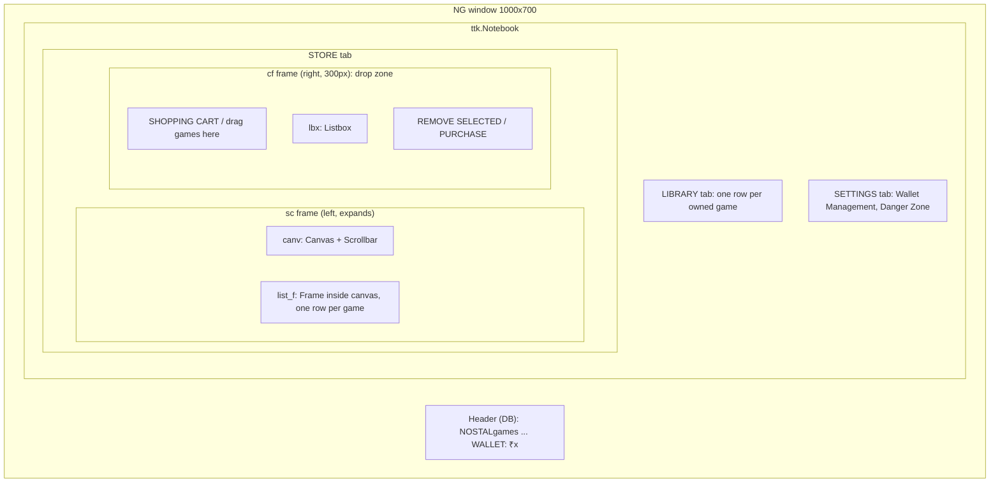
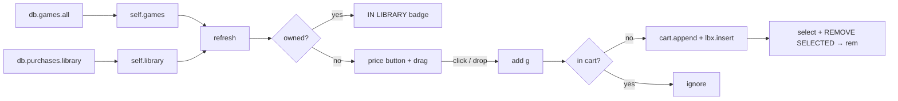

# Store, Cart and Library

The main window: header with the wallet, and the STORE, LIBRARY and SETTINGS tabs. This doc covers how the window is built, how the game list and library are drawn, and how the cart works. Purchasing is in [purchase.md](purchase.md); wallet controls are in [wallet-and-reset.md](wallet-and-reset.md).

## Code

All in `nostalgames.py`, class `NG(tk.Tk)`:

| Method | Purpose |
|---|---|
| `__init__(db, username)` | Build the whole window, load data, draw |
| `load_data()` | Read wallet and library from MySQL into `self.wallet`, `self.library` |
| `save_data()` | Write `self.wallet` to MySQL |
| `refresh()` | Rebuild the wallet label, the store rows and the library rows |
| `add(g)` | Put a game in the cart |
| `rem()` | Remove the selected cart item |

## State

| Attribute | Type | Source |
|---|---|---|
| `self.db` | `Database` | passed in |
| `self.username` | `str` | passed in |
| `self.games` | `dict[str, int]` name → price | `db.games.all()` at start-up |
| `self.wallet` | `float` | `db.users.wallet()` |
| `self.library` | `list[str]` owned games | `db.purchases.library()` |
| `self.cart` | `list[str]` | starts empty; in memory only |
| `self.lbx` | `tk.Listbox` | the visible cart; always mirrors `self.cart` |

The cart is never saved. Closing the window empties it.

## Window layout



The game list sits in a `Frame` (`list_f`) embedded in a `Canvas` with `create_window`, because a `Canvas` can scroll and a `Frame` can't. Whenever `list_f` changes size, its `<Configure>` handler resets the canvas `scrollregion` to fit the content. Scrolling itself is covered in [store-scrolling.md](store-scrolling.md).

## Start-up order in `__init__`

1. Create the `Tk` window; store `db`, `username`, empty `cart`, and `games = db.games.all()`.
2. `load_data()` reads the wallet and library.
3. Configure the notebook tab styles and the `Remove`, `Buy`, `Reset` and `Price` button styles.
4. Build the header, notebook and three tab frames.
5. Build the STORE tab: canvas, scrollbar and `list_f` on the left, and the cart frame `cf` on the right. Create `self.drag = DragToCart(self, cf, self.add)`, so the whole cart frame is the drop zone.
6. Build the SETTINGS Danger Zone.
7. `refresh()` draws everything that depends on data.

`NGext.__init__` then adds Wallet Management, and `NGadmin.__init__` adds the admin tabs.

## `refresh()`: redraw from state

```python
def refresh(self):
    self.w_lbl.config(text=f"WALLET: ₹{self.wallet}  ")
    for f in [self.list_f, self.tabs["LIBRARY"]]:
        for w in f.winfo_children(): w.destroy()

    for g, p in self.games.items():
        row = tk.Frame(self.list_f, ...); row.pack(fill="x", pady=5)
        name = tk.Label(row, text=g, ...); name.pack(side="left")
        if g in self.library: tk.Label(row, text="IN LIBRARY", ...).pack(side="right")
        else: ttk.Button(row, text=f"₹{p}", style="Price.TButton", width=12,
                         command=lambda x=g: self.add(x)).pack(side="right"); self.drag.attach(g, row, name)

    for g in self.library:
        r = tk.Frame(self.tabs["LIBRARY"], ...); r.pack(...)
        tk.Label(r, text=f"🎮 {g}", ...).pack(side="left")
```

- Every redraw destroys and recreates all rows. With a dozen games this takes about 30–75 ms, and it keeps the screen exactly in sync with the data.
- **Owned games** get an **IN LIBRARY** badge, with no button and no drag.
- **Unowned games** get a price button and are registered with `DragToCart` (both the row frame and the name label respond to dragging).
- `lambda x=g: self.add(x)` binds the current game as a default argument. A plain `lambda: self.add(g)` would make every button add the last game in the loop.

## Cart operations

```python
def add(self, g):
    if g not in self.cart: self.cart.append(g); self.lbx.insert("end", f" {g}")

def rem(self):
    s = self.lbx.curselection()
    if s: self.cart.pop(s[0]); self.lbx.delete(s[0])
```

- `self.cart` and `self.lbx` are kept index-aligned: item *i* in the list is row *i* in the listbox, which is what lets `rem()` delete by the selected index.
- `add` is the single entry point for both the price button and drag and drop, so the "no duplicates" rule lives in one place.
- The listbox is created with `exportselection=False`, so its selection isn't cleared when another widget (e.g. the wallet amount box) takes the text selection.

## Flow: browsing to cart



## Edge cases

- **Game ownership is taken from `self.library`, refreshed after each purchase or reset.** If the same account buys a game in another app instance, this window still offers it until its next refresh; the purchase would then hit the `UNIQUE (username, game)` constraint and be rolled back (see [purchase.md](purchase.md#edge-cases)).
- **`self.games` is read once.** Players see admin catalogue changes only on next launch. The admin's own window reloads it immediately (see [admin-panel.md](admin-panel.md)).
- **There is a module-level `def reset(self)` below the class**, kept from the original code. Nothing calls it; the button uses the `NG.reset` method.
