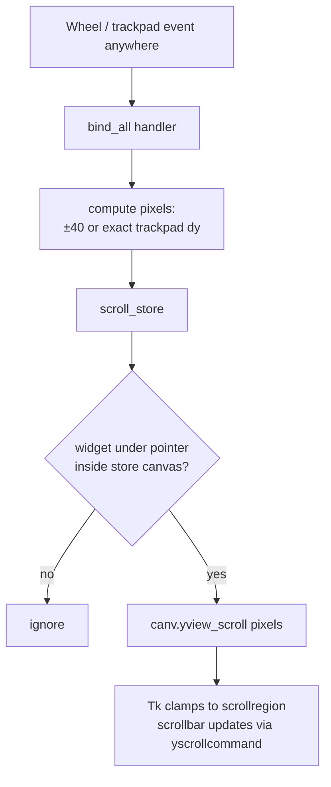

# Store Scrolling

The STORE game list is taller than the visible area (about 804 px of rows in a 555 px viewport at the default window size). It scrolls with the scrollbar, a mouse wheel or a trackpad.

## Code

In `NG.__init__` (`nostalgames.py`):

```python
self.canv = tk.Canvas(sc, bg=B, highlightthickness=0, yscrollincrement=1)
sb = ttk.Scrollbar(sc, orient="vertical", command=self.canv.yview); sb.pack(side="right", fill="y")
self.canv.configure(yscrollcommand=sb.set); self.canv.pack(side="left", fill="both", expand=1)
self.bind_scroll()
self.list_f = tk.Frame(self.canv, bg=B); self.canv.create_window((0,0), window=self.list_f, anchor="nw", width=600)
self.list_f.bind("<Configure>", lambda e: self.canv.configure(scrollregion=self.canv.bbox("all")))
```

and two methods:

```python
def bind_scroll(self):
    self.bind_all("<MouseWheel>", lambda e: self.scroll_store(e, -40 if e.delta > 0 else 40))
    self.bind_all("<Button-4>", lambda e: self.scroll_store(e, -40))
    self.bind_all("<Button-5>", lambda e: self.scroll_store(e, 40))
    try: self.bind_all("<TouchpadScroll>", lambda e: self.scroll_store(e,
            -int(self.tk.splitlist(self.tk.call("tk::PreciseScrollDeltas", e.delta))[1])))
    except tk.TclError: pass

def scroll_store(self, e, pixels):
    w = self.winfo_containing(e.x_root, e.y_root)
    if w and str(w).startswith(str(self.canv)): self.canv.yview_scroll(pixels, "units")
```

## How it works

### Scrollable content

A `Frame` can't scroll, so the rows live in `list_f`, which is embedded in a `Canvas` with `create_window`. Each time `list_f` changes size (after every `refresh()`), its `<Configure>` handler sets the canvas `scrollregion` to the bounding box of the content.

### Scrollbar link

- `Scrollbar(command=canv.yview)`: dragging the bar scrolls the canvas.
- `canv.configure(yscrollcommand=sb.set)`: scrolling the canvas moves the bar.

### Scroll units

`yscrollincrement=1` makes one "unit" equal one pixel, so `yview_scroll(40, "units")` moves exactly 40 px. Trackpads report pixel deltas, which can then be applied 1:1.

### Input sources

| Source | Event | Amount |
|---|---|---|
| Mouse wheel on macOS / Windows | `<MouseWheel>`, `e.delta` > 0 means up | ±40 px per event (sign only, since delta scales differ by platform) |
| Mouse wheel on Linux X11 | `<Button-4>` up, `<Button-5>` down | ±40 px |
| Trackpad on Tk 9 (macOS) | `<TouchpadScroll>`; `e.delta` packs x and y deltas into one int | exact pixel `dy`, decoded with Tk's `tk::PreciseScrollDeltas` |
| Trackpad on Tk 8.6 | arrives as `<MouseWheel>` | ±40 px |

`<TouchpadScroll>` was added in Tk 9 (the Homebrew `python-tk` this project uses). On Tk 8.6, binding it raises `TclError`, which is caught so the app still runs.

### Pointer check

`bind_all` catches wheel events anywhere in the app. `scroll_store` finds the widget under the pointer with `winfo_containing` and only scrolls if its Tk path starts with the canvas's path (i.e. it is the canvas or one of the game rows inside it). Scrolling over the cart, the library or the admin tables doesn't move the store list. Treeviews in the admin tabs still scroll with their own built-in bindings, which run before the `all` binding.

## Flow



## Edge cases

- **Content shorter than the view:** Tk confines the view to the scroll region, so nothing moves.
- **Drag and drop after scrolling:** `DragToCart` uses screen coordinates, so it is unaffected by the scroll position.
- **Horizontal trackpad movement** is ignored; only `dy` is used.
