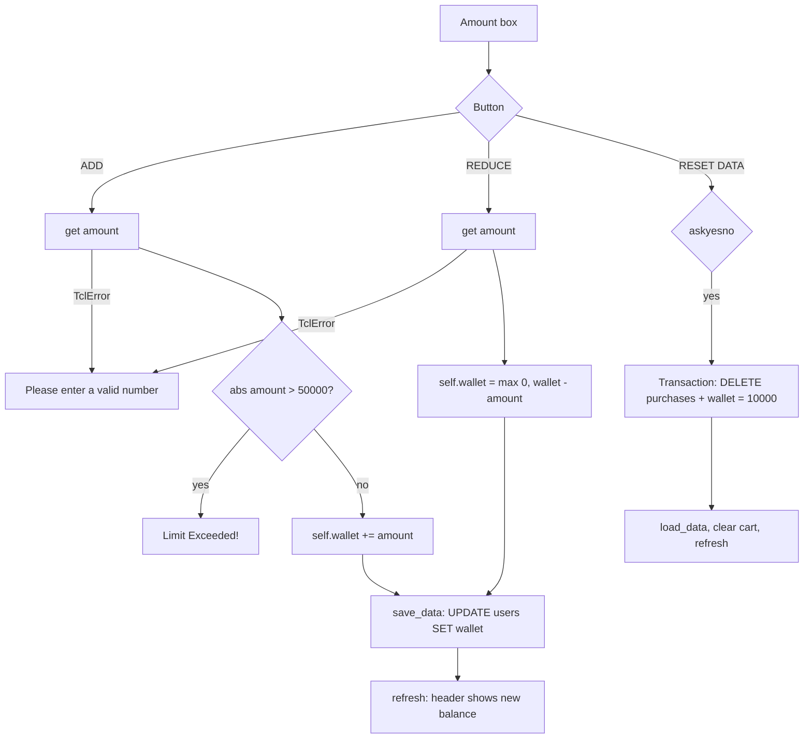

# Wallet and Reset

The SETTINGS tab: **Wallet Management** (ADD / REDUCE money) and the **Danger Zone** (RESET DATA).

## Code

| Piece | File | Role |
|---|---|---|
| `NGext.add_wallet_controls()` | `nostalgames.py` | Builds the Wallet Management box |
| `NGext.add_money()` / `reduce_money()` | `nostalgames.py` | ADD / REDUCE handlers |
| `NG.save_data()` | `nostalgames.py` | Writes `self.wallet` to MySQL |
| `NG.reset()` | `nostalgames.py` | RESET DATA handler |
| `UserTable.set_wallet()` | `db.py` | `UPDATE users SET wallet = %s WHERE username = %s` |
| `UserTable.reset()` | `db.py` | Delete purchases and restore ₹10,000 in one transaction |

`NG` builds the Danger Zone. `NGext` (the class actually opened for players) adds Wallet Management above it:

```python
wm_frame.pack(fill="x", padx=50, pady=(20, 0), before=self.tabs["SETTINGS"].winfo_children()[0])
```

`before=` packs the new frame ahead of the first existing child (the Danger Zone), so it appears on top.

## Amount box

```python
self.amount_var = tk.DoubleVar(value=1000.0)
tk.Entry(wm_frame, textvariable=self.amount_var, ...)
```

`DoubleVar.get()` parses the entry text as a float and raises `tk.TclError` if it isn't a number. Both handlers catch that error. `abs()` turns negative input into positive, so `-500` behaves like `500`.

## ADD

```python
def add_money(self):
    try:
        addamount=abs(self.amount_var.get())
        if addamount>50000.0:
            messagebox.showerror("Limit Exceeded!"," You can only add upto ₹50000 at a time.")
            return
        self.wallet += addamount
        self.save_data()
        self.refresh()
    except tk.TclError:
        messagebox.showerror("Error", "Please enter a valid number.")
```

## REDUCE

```python
def reduce_money(self):
    try:
        self.wallet = max(0.0, self.wallet - abs(self.amount_var.get()))
        self.save_data()
        self.refresh()
    except tk.TclError:
        messagebox.showerror("Error", "Please enter a valid number.")
```

`max(0.0, ...)` floors the wallet at zero instead of rejecting a large reduction.

## RESET DATA

```python
def reset(self):
    if messagebox.askyesno("Reset", "Wipe all data?"):
        self.db.users.reset(self.username)
        self.load_data(); self.cart = []; self.lbx.delete(0, "end"); self.refresh()
```

```python
def reset(self, username):                         # UserTable
    self.db.run(("DELETE FROM purchases WHERE username = %s", (username,)),
                ("UPDATE users SET wallet = %s WHERE username = %s", (START_WALLET, username)))
```

Both statements run in one transaction. After it, all games return to the store with price buttons and the cart is cleared.

## Flow



## Known limitation: ADD/REDUCE use the in-memory balance

ADD and REDUCE start from `self.wallet`, the value last loaded by the app, and then write the result with `set_wallet`. If the wallet was changed outside the app (e.g. in MySQL Workbench) since the last `load_data()`, that change is overwritten.

Purchases are not affected; they check the stored value in SQL (see [purchase.md](purchase.md)). A future fix is to call `self.load_data()` at the start of both handlers, or to update relatively in SQL (`SET wallet = wallet + %s`).

## Edge cases

- **Amount `0`:** ADD and REDUCE succeed and change nothing.
- **Very large REDUCE:** the wallet goes to ₹0.0; there is no error.
- **ADD has no overall cap:** repeated ADDs can grow the wallet up to the column limit, `DECIMAL(10,2)` (₹99,999,999.99). Beyond that, MySQL raises an out-of-range error.
