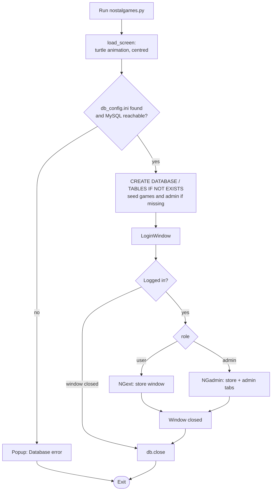
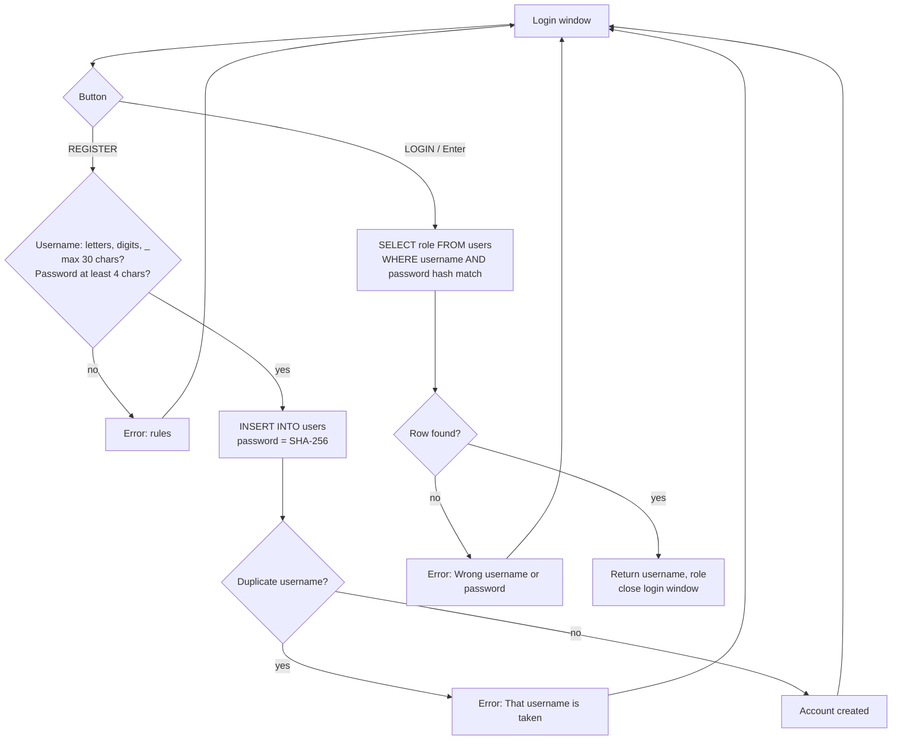
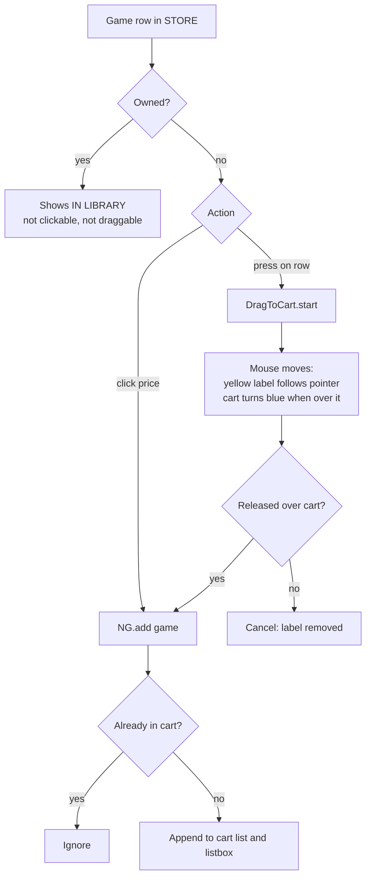
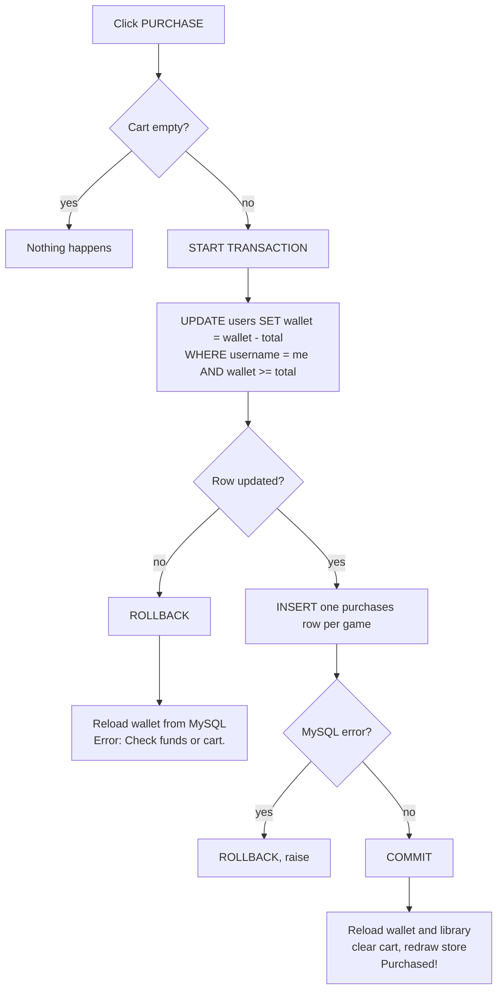
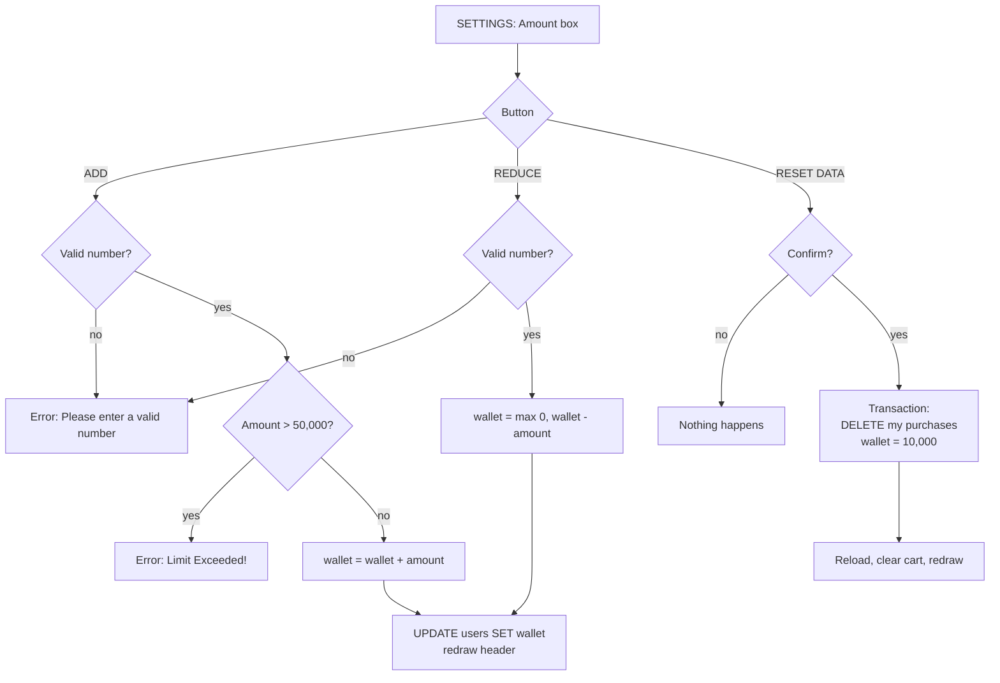
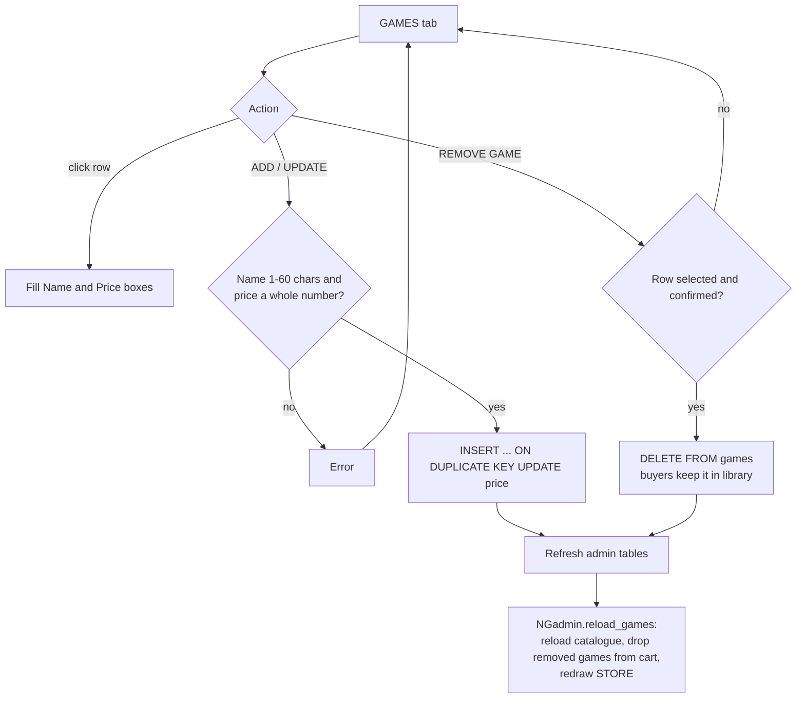
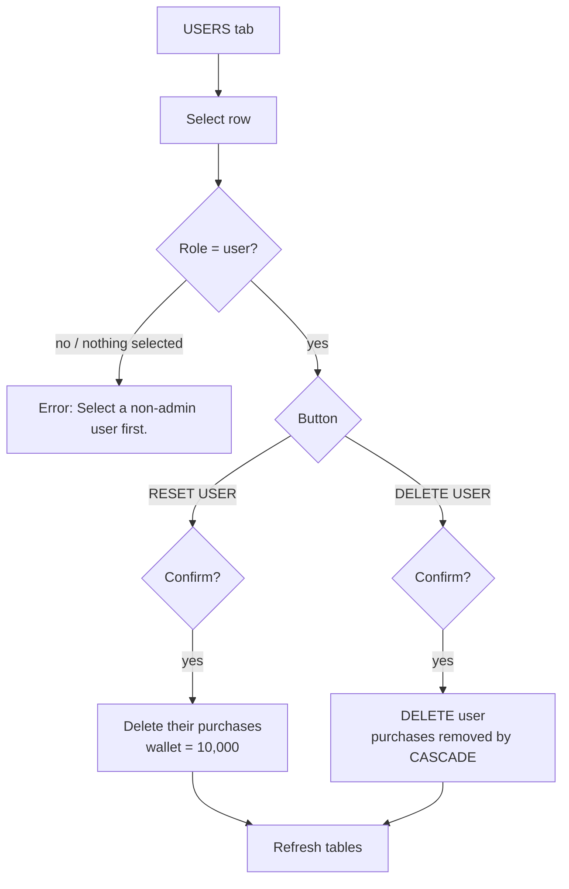

# Flows

Step-by-step flowcharts of the main paths through NOSTALgames. For the module and class structure see [architecture.md](architecture.md); for actors and rules see [use-cases.md](use-cases.md).

## Application start-up

## Login and registration

## Adding to the cart

## Purchase

## Wallet management

## Admin: managing games

## Admin: managing users

