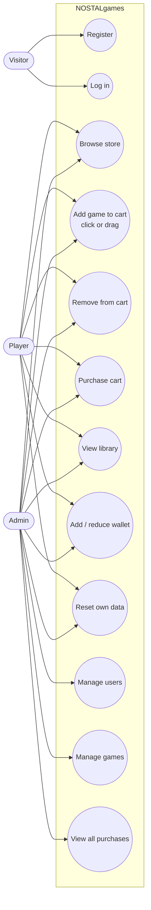

# Use Cases

Who uses NOSTALgames and what each of them can do.

## Actors

| Actor | Description |
|---|---|
| **Visitor** | Someone at the login screen without an account yet |
| **Player** | A logged-in account with role `user` |
| **Admin** | A logged-in account with role `admin`; can do everything a Player can, plus manage the store |
| **MySQL** | The database server; it stores all data and enforces the wallet and ownership rules |

## Use case diagram

## Use case details

### UC1 Register

| | |
|---|---|
| **Actor** | Visitor |
| **Precondition** | App is running and connected to MySQL |
| **Main flow** | 1. Enter a username and password. 2. Click REGISTER. 3. System checks the rules and inserts a `user` row with the hashed password and a ₹10,000 wallet. 4. System shows "Account created". |
| **Alternatives** | Invalid username (not letters/digits/`_`, or over 30 characters) or password under 4 characters: error, nothing saved. Username already exists: "That username is taken". |
| **Postcondition** | A new Player account exists |

### UC2 Log in

| | |
|---|---|
| **Actor** | Visitor |
| **Main flow** | 1. Enter username and password. 2. Click LOGIN or press Enter. 3. System checks the hashed password. 4. A Player gets the store window; an Admin gets the store window plus admin tabs. |
| **Alternatives** | Wrong username or password: "Wrong username or password", stay on the login screen. Window closed: app exits. |

### UC3 Browse store

| | |
|---|---|
| **Actor** | Player, Admin |
| **Main flow** | Open the STORE tab. Every game is listed with its price, or **IN LIBRARY** if already owned. |

### UC4 Add game to cart

| | |
|---|---|
| **Actor** | Player, Admin |
| **Precondition** | The game is not owned |
| **Main flow** | Click the game's price button, **or** drag the game row onto the SHOPPING CART and release. The game appears in the cart. |
| **Alternatives** | Game already in cart: nothing happens. Dropped outside the cart: nothing happens. |

### UC5 Remove from cart

| | |
|---|---|
| **Actor** | Player, Admin |
| **Main flow** | Select a cart item (it turns yellow), click REMOVE SELECTED. |
| **Alternatives** | Nothing selected: nothing happens. |

### UC6 Purchase cart

| | |
|---|---|
| **Actor** | Player, Admin, MySQL |
| **Precondition** | Cart is not empty |
| **Main flow** | 1. Click PURCHASE. 2. In one transaction MySQL subtracts the total from the stored wallet only if the wallet covers it. 3. One purchase row per game is inserted. 4. Transaction commits. 5. Wallet and library refresh; "Purchased!". |
| **Alternatives** | Stored wallet too low: transaction rolled back, nothing charged or saved, wallet display refreshed, "Check funds or cart.". |
| **Postcondition** | Games are in the library, wallet reduced by the total, cart empty |

### UC7 View library

| | |
|---|---|
| **Actor** | Player, Admin |
| **Main flow** | Open the LIBRARY tab: every owned game, in purchase order. |

### UC8 Add / reduce wallet

| | |
|---|---|
| **Actor** | Player, Admin |
| **Main flow** | SETTINGS → Wallet Management: enter an amount, click ADD or REDUCE. The new balance is saved and shown in the header. |
| **Alternatives** | Not a number: "Please enter a valid number". ADD over ₹50,000: "Limit Exceeded!". REDUCE below zero: wallet set to ₹0. |

### UC9 Reset own data

| | |
|---|---|
| **Actor** | Player, Admin |
| **Main flow** | SETTINGS → RESET DATA → confirm. All own purchases are deleted and the wallet returns to ₹10,000 in one transaction. |

### UC10 Manage users

| | |
|---|---|
| **Actor** | Admin |
| **Main flow** | USERS tab: select a Player, then RESET USER (clear library, wallet ₹10,000) or DELETE USER (remove account and purchases), and confirm. |
| **Alternatives** | No selection, or an admin selected: "Select a non-admin user first." |

### UC11 Manage games

| | |
|---|---|
| **Actor** | Admin |
| **Main flow** | GAMES tab: enter a name and price and click ADD / UPDATE (adds a new game or changes the price of an existing one), or select a game and click REMOVE GAME. The store list updates immediately. |
| **Alternatives** | Empty name, name over 60 characters, or price not a whole number: error, nothing saved. |
| **Postcondition** | A removed game disappears from the store and from the admin's cart; buyers keep it in their library |

### UC12 View all purchases

| | |
|---|---|
| **Actor** | Admin |
| **Main flow** | PURCHASES tab: every purchase, newest first, with user, game, price paid and date. Refreshes each time the tab opens. |

## Business rules

| Rule | Enforced by |
|---|---|
| A new account starts with ₹10,000 | `users.wallet` column default |
| A user can own each game only once | `UNIQUE (username, game)` on `purchases`; owned games can't be added to the cart |
| A purchase can't exceed the stored wallet | Guarded `UPDATE ... WHERE wallet >= cost` inside the purchase transaction |
| A purchase saves completely or not at all | `Database.run()` transaction with rollback |
| ADD is capped at ₹50,000 per click | `NGext.add_money` |
| The wallet never goes below ₹0 via REDUCE | `NGext.reduce_money` |
| Admin accounts can't be reset or deleted from the app | `AdminTabs.selected_user` and `DELETE ... AND role = 'user'` |
| Deleting a user deletes their purchases | `ON DELETE CASCADE` |
| Removing a game keeps it in buyers' libraries | `purchases.game` is not a foreign key to `games` |
